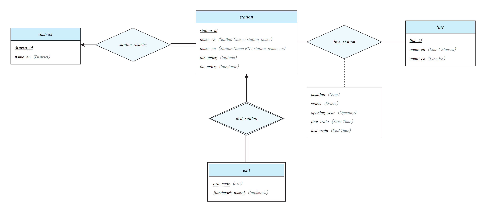
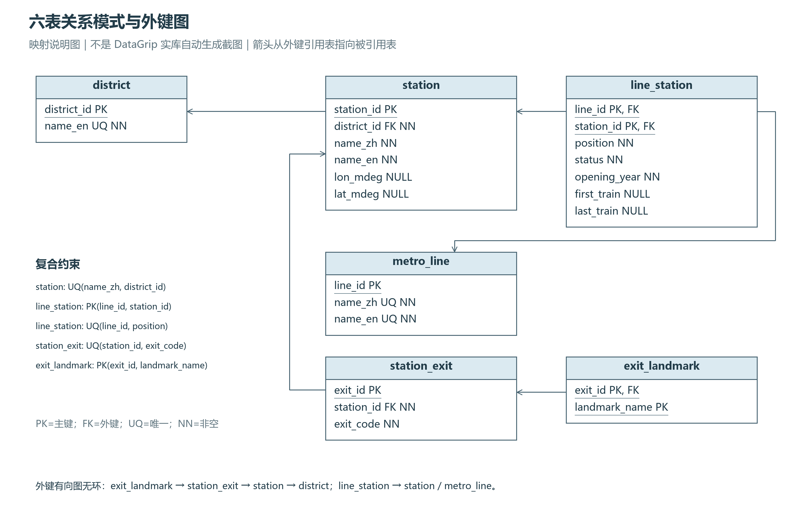

# 依据 Lecture 7 的 ER 设计与项目要求说明

修订日期：2026-11-12。

本设计依据《ZQ_Fall2026_CS307_Lecture7.pdf》的概念建模规范，以及《CS307-Fall26-project1.pdf》的任务约束，并与当前 `Project1_v0/sql/schema.sql` 逐表核对。本轮绘图和解释没有修改数据库结构、源 CSV 或既有业务代码。课件中的作业公告只是材料内容，不作为本轮操作指令。





## 1. 先区分概念 ER 图与数据库关系图

用于 Task 1 的是本目录 **概念ER图_Lecture7.png / .svg**（另有同记法的 draw.io 版本 `概念ER图_drawio.drawio` + `E-R_project1.png`，同样把出口画成弱实体，两版取其一即可）。矩形表示实体集，菱形表示联系集，实线下划线标主键。箭头指向「一」端，双线表示全参与，实体侧 `l..h` 标参与次数。双矩形表示弱实体，双菱形表示识别联系，虚线下划线表示部分键。联系属性放在与菱形虚线连接的属性框内，多值属性用花括号。


课件不是所有属性都画椭圆的传统 Chen 图，也不是乌鸦脚表结构图。因此，此次没有直接将之前的六表 Mermaid 图充当课件要求的概念图。

另提供 **六表关系映射图.png / .svg**，解释概念设计如何落到现有表和外键。Task 2 的正式配图使用 [DataGrip-project1.png](DataGrip-project1.png)，由 DataGrip 2026.2.5 连接实际 PostgreSQL 验证库后从 `project1` 导出。

绘图软件/工具可如实填写：Task 1 图为 **diagrams.net（draw.io）**，源文件 `概念ER图_drawio.drawio`，PNG 由 diagrams.net viewer 渲染导出（`tools/draw_er_drawio.py` 复现该流程，内置离线渲染器作后备）；早期版本为 **Python 3 + Pillow**，源文件 `tools/draw_er_lecture7.py`（SVG + 3600×2320 PNG）。图中文字与图形由程序绘制，未复制课件图形或网络图片。重新生成需安装 Pillow 和微软雅黑/ Times 字体。

## 2. 为什么不是“CSV 一张表”或“六个概念实体”

主 CSV 的567行表示“一个站在线路上的一次出现”，不是567个独立车站。按中文名和行政区区分后有439个物理车站，线路有29个。换乘站会在多条线上出现；其站名等信息不应重复维护。

最终有六张表，**不代表概念层必须有六个实体集**。本方案的来源是：

| 概念对象 | 在概念图中的表示 | 转换后的关系表 |
|---|---|---|
| 行政区 | District 实体 | district |
| 车站 | Station 实体 | station |
| 线路 | MetroLine 实体 | metro_line |
| 出口 | StationExit 弱实体，由 Station 识别 | station_exit |
| 某线路经过某站 | Station 与 MetroLine 之间带属性的多对多联系 | line_station |
| 一个出口关联的多个地标名称 | StationExit 的 `{landmark_name}` 多值属性 | exit_landmark |

依据课件第57页，多对多联系转成独立关系，其列包括两端实体的键与联系属性；依据第55页，多值属性转成“所属实体键＋单个属性值”的独立关系。因此“四个实体＋一个多对多联系＋一个多值属性”恰好自然映射成现有六表。

## 3. 四类实体为什么这样划分

### 3.1 District：行政区

表示CSV中出现的行政区。属性为 `district_id`（选定主键）和 `name_en`（业务唯一名称）。独立成实体，使同一区的名称只维护一处，并直接支持Q3分区统计。

行政区也可以仅作为站点的文本属性；这不是在所有场景都错误。但本项目有10个区、439个站点，且Q3明确按行政区聚合，因此小字典实体能统一取值、提供外键检查。代价是一次小表连接；不能仅凭“拆表”就宣称一定更快或更小。

### 3.2 Station：物理车站

表示独立的物理车站，而不是某条线路上的车站记录。属性为 `station_id`、中文名、英文名和可空坐标。线路站序、开通年、状态、首末班时间不属于这一层。

**为什么主键不能直接取中文名或英文名？** 源数据有两个“梨园 / Liyuan”：一个在Longgang，另一个在Luohu；“塘坑”和“汤坑”还共用英文名Tangkeng。只按名称识别会合并不同站，令Q1少算，并让路径查询出现虚假换乘。因此采用稳定 `station_id`，并在关系层以 `UNIQUE(name_zh,district_id)` 实现当前数据的业务候选键。

“中文名＋所属行政区”唯一是当前项目范围的建模约定，不是对所有未来地铁数据的永久保证；若未来同一区存在同名不同站，需要引入新的来源标识，而不是继续强行合并。

### 3.3 MetroLine：线路及独立分期

表示CSV中的完整线路身份。属性为 `line_id`、中文名和英文名；两种名称分别唯一。不把 `Line 6 Branch` 或 `Line 13 Phase 2 North Extension` 简化成主线数字，否则Q2无法维持29条线路，也会丢失分期站序边界。

线路实体独立存在，使“先创建一条空线路，后添加站点”成为合法操作；这对应课件第9页强调的“不完整性”问题：不能因为线路暂时没有站点记录就无法表示该线路。

### 3.4 StationExit：出口

表示一个车站内的原子出口，具有部分键 `exit_code` 及多值地标名称。出口号 A、B、1 等会在不同车站重复；CSV 里没有全局出口编号。只有结合所属车站才能识别一个出口。

图中按 Lecture 7 第45–46页使用双矩形、双菱形、部分键虚线下划线及出口侧双线；箭头指向负责识别的车站。概念身份是「所属车站＋出口编号」。若直接转换，关系键为 `(station_id,exit_code)`。

实际 SQL 用 `UNIQUE(station_id,exit_code)` 保留这个候选键，同时用整数代理主键 `exit_id` 连接地标，避免在每条地标关系重复存储文本出口编号和车站编号。这个数据库实现键不画进概念 ER。出口即使没有地标也必须保留，否则会影响 Q5 的出口数。

## 4. 联系、基数与参与约束

箭头采用课件第31、46页的画法，指向「一」端；数字采用第35页的实体侧参与次数标法。标在 Station 旁的 `1..1` 指每个 Station 恰好参加一次归属行政区联系。

| 联系 | 每个左侧实体参加次数 | 每个右侧实体参加次数 | 含义与落地 |
|---|---|---|---|
| District — 归属行政区 — Station | District：0..* | Station：1..1，全参与 | 一个区可有零到多个站，每站必须属于一个区；station.district_id非空FK |
| Station — 经过 — MetroLine | Station：0..* | MetroLine：0..* | 换乘站可属于多线，一线可经过多站；line_station两个非空FK及复合PK |
| Station — 拥有 — StationExit | Station：0..* | StationExit：1..1，全参与 | 识别联系；每个出口只属于一站，车站可以没有已记录出口；station_exit.station_id非空FK |

**为什么Station与MetroLine允许0而不是强制1？** 初始CSV中的站和线均有关联，但项目CRUD要求独立新增站、线和移出线路。允许先新增站、暂不编线，或线路暂时为空，可使这些操作自然成立，也与当前数据库没有“父行必须有子行”的约束相符。若画成全参与，现有实现就必须额外强制任何时刻每站/每线都有关系，这与当前CRUD流程不符。

**为什么车站到出口允许0？** 出口文件覆盖340个中文站名，不是全部车站；在建站、缺失出口资料的站不能因此被排除。0个出口记录只表示本数据没有记录，不证明真实车站一定无出口。

多值地标集合也允许为空：出口存在，但没有地标关联。数据库用0条exit_landmark记录表示空集合，不用一条空字符串或虚构“未知地标”替代。

## 5. “经过”为什么拥有站序、开通年、状态和时刻

判断属性归属的方法是：**只知道车站，能否唯一确定该值？只知道线路，能否唯一确定？**

- `position`：同一换乘站在不同线路的位置不同，只有“指定站＋指定线”才有明确站序。
- `opening_year`：世界之窗在Line 1为2004、Line 2为2010，不能在Station上只留一个年份来回答Q4。
- `status`：一个已运营车站还可能被在建延伸线经过；若只给整站写Construction或Operation，会覆盖另一条线的事实。
- `first_train / last_train`：源数据按线路站点记录提供；换乘站的不同线路时间可能不同，也可能为空，不能用全站或全线统一时刻覆盖。

所以它们作为“经过”联系的描述属性，用虚线连接属性框，符合课件第18–19页及第72页。转成表后得到：

```text
line_station(line_id, station_id, position, status,
             opening_year, first_train, last_train)
主键：(line_id, station_id)
另一候选键：(line_id, position)
```

这也限定了当前模型：同一站在同一条线路中最多出现一次。若以后用同一线路表示多种交路，或同站在一条运行序列中重复出现，则需增加route/occurrence等标识，不能沿用现有复合键直接塞入。

**概念图为什么不把line_id、station_id再写进联系属性框？** 课件第63页明确指出，联系两端实体的键在联系语义中已经隐含；把它们当作联系的描述属性重复画入是常见错误。它们只在映射成line_station表时被显式引入。

## 6. 为什么地标先采用多值属性

CSV为每个出口提供一串地标名称，一个出口可有多个名称。当前没有地址、类型、坐标或可信的独立地标ID。因此概念层把它画成 `{landmark_name}`，而不是额外制造具有大量不存在属性的Landmark实体。

依据第55页，转换为：`exit_landmark(exit_id,landmark_name)`，联合主键覆盖整行。数据库内每行仍是一个原子文本，**概念层允许多值属性并不意味着关系表可以存逗号分隔列表**。

相同名称出现在多个出口时，本方案保存多条“出口—名称”关联，不声称同名一定是同一真实地点。Q6和地标路线都能由名称反查出口与站点。缺点是部分名称文本重复；优点是少一张实体表和一套主键/唯一索引，也避免无依据合并同名地点。3,203个原始地标条目中有2,872个不同文本，重复文本较少，仅为去重建独立地标实体的空间收益有限，不能忽略新增元组和索引成本。

若项目扩展为“同一真实地标有地址/类型/坐标，多个出口可到达它”，应改为Landmark实体和出口—地标M:N联系。该七表版本更适合那个新需求，但并不是当前满足3NF的必要条件。

## 7. 从概念图到六表：为什么1:N联系没有额外表

Lecture 7第58页说明：多方全参与的多对一/一对多联系，可通过将一方主键放入多方表实现。因此：

1. District与Station的“位于”→station表增加district_id非空外键，不另建station_district。
2. Station 与 StationExit 的“拥有”→station_exit 表增加 station_id 非空外键，和 exit_code 形成业务候选键，不另建 station_owns_exit。
3. Station与MetroLine的M:N“经过”→独立line_station表。
4. StationExit的多值地标→独立exit_landmark表。

概念图故意不在Station属性内重复district_id，也不在StationExit内重复station_id，所属关系已由菱形明确表达；依据第49、62页，这样避免概念图重复。**映射图和SQL中必须恢复这些外键**，两层表示不同，并非字段丢失。

六表字段、PK、FK和业务UNIQUE详见本目录关系映射图与实际schema.sql。候选键不要求每个都选作主键；例如Station选择station_id，但仍用UNIQUE保证业务身份。

## 8. 与项目评分和功能逐项对应

图中用「← 原列名」直接标出两份 CSV 的全部列（主表 12 列、出口表 4 列）。`District` 是行政区实体的名称，车站与行政区通过联系对应；出口表的 `station_name` 和 `station_name_en` 对应车站名称，出口通过识别联系归属车站。两份 CSV 共享的名称只建模一次；`Num` 是线路上的站序。`latitude` 列数值约为 114，故映射到概念经度；`longitude` 列约为 22，映射到概念纬度。

| 项目要求/功能 | 本设计如何满足 | 若采用错误设计的影响 |
|---|---|---|
| Task 1：标准概念图 | 课件矩形、菱形、联系属性、多值、基数、参与约束齐全 | 只交数据库表框图不能解释概念联系 |
| Task 2：三范式 | 原子出口/地标；实体信息分开；联系属性依赖完整站线组合；区名不在站表重复 | 逗号字段、换乘站冗余、更新异常 |
| 每表主键/业务唯一/非空 | 六表都有PK和非ID必填字段；实体加业务UNIQUE，关联表由复合PK/UQ约束 | 自增ID本身不能阻止重复业务记录 |
| 每表参与外键且无环 | 六表均引用或被引用；有向依赖见下文 | 给行政区加反向FK会无谓制造环 |
| Q1/Q2：439站、29线 | 按物理站身份和完整线路分别存储 | 中文名去重只有438；只取线路数字会合并分期 |
| Q3：分区运营站 | Station所属District；通过任一Operation经过关系判断运营，用EXISTS避免换乘重复 | 直接数line_station会重复数换乘站 |
| Q4：线路开通年 | opening_year位于“经过”联系 | 用物理站最早开通年会误算后开通线路 |
| Q5：最多出口、并列全返回 | 独立原子出口，在站点层计数；不连地标放大数量 | 同一出口多个地标会被重复计数 |
| Q6：地标前缀查站/区/出口 | 地标原子化后沿出口→车站→区连接 | 对整串描述LIKE只匹配首项，漏掉后面的地标 |
| Q7：前后第n站 | 同线路position唯一且初始连续，支持position±n定位 | 只保存站名列表无法可靠定位或更新 |
| Task 4：增删改查及批量插站 | Station/MetroLine独立；操作line_station表示编排，不随意删物理站 | 删除线路关系可能误删其他线共用的站 |
| 路径/地标路线 | 同站ID形成换乘；相邻站序推导边；出口地标提供起终点候选 | 同名站合并产生虚假换乘，推断分期连接产生虚假路径 |
| 票价扩展 | 现阶段不在图里虚构票价属性；需要认可数据再增加模型 | 站数和直线距离不能自动当真实票价 |

外键方向为：

```text
exit_landmark → station_exit → station → district
line_station → station
line_station → metro_line
```

它是有向无环图。项目禁止的是外键方向环，不是禁止地铁拓扑形成环，也不是禁止概念图出现多对多。每张表“参与外键”包括被其他表引用；行政区、线路不需要再加无意义外键。

范式解释以明确的语义依赖为前提：station_id决定站点描述，line_id决定线路描述；(line_id,station_id)决定站序/年份/状态/时刻；exit_id决定所属站与代码；exit_landmark只有整个复合键而无非键属性。不能仅以“画了多张表”或“用了自增ID”作为3NF证明。

## 9. 查询时间与空间：哪些属于ER，哪些属于物理实现

ER首先决定数据含义和约束，不会单凭图形保证某次查询最优。第8页把逻辑设计与索引等物理设计区分开来。本设计在保留正确性的同时减少重复维护：

- 换乘站名称/坐标只存一份，线路名称只存一份，线路关系使用整数键。
- `(line_id,position)`唯一约束为站序查询提供索引；Q7不需要遍历整条线或保存所有站对。
- 出口地标保留原子值，现有前缀索引服务Q6；不把索引字段画成新的概念实体。
- 邻接边由相邻站序推导；出口数、线路站数、运营站总数均为派生结果，不再保存易失真的计数字段。课件第25–26页允许派生属性；本图为保持简洁没有画这些可选派生项。

站序唯一不等于连续：UNIQUE和CHECK只能保证不重复、值为正，不能保证恰好1…m；连续性由导入核验与插站/移站事务维护，不能把程序保证错误标成数据库声明约束。

## 10. 数据假设与报告使用边界

1. 梨园两个站必须区分；出口CSV没有区信息，B/C出口归Longgang的映射是已有配置假设，依据唯一运营候选及地标文本，仍须课程确认。
2. 组合出口按枚举/明确数字区间展开，组地标分配给各成员出口；这是对源文件的解释，不是新增实地测绘事实，计数口径须披露。
3. 经纬度列的数值范围与表头疑似相反，当前按已披露映射转为千分度整数；缺失坐标保持NULL。图中坐标属于物理站，不属于线路关系。
4. 没有地标的出口保持实体、地标集合为空；不能因缺失字段删除整个对象。
5. 本文是设计解释材料，不是整份5–7页课程最终报告。建议Task 1放概念图和精简说明；Task 2放真实客户端关系图并解释映射、键和字段，DDL仍单独提交。

### 可供组员理解后改写的精简说明

本项目将行政区、物理车站、线路建模为强实体，将出口建模为弱实体。一个出口由所属车站及出口编号识别，其多个地标名称作为多值属性。站序、状态、开通年份及首末班时间是车站与线路之间「经过」联系的属性。多对多联系形成 line_station，多值地标形成 exit_landmark；两个一对多联系通过非空外键落实，最终得到六张表。该结构区分同名不同站，支持换乘、线路年度统计、出口和地标查询以及线路位置维护。站序连续性由事务及导入校验维护。

## 11. 核对依据

- Lecture 7：第14页实体矩形/键下划线；17–19页联系菱形/联系属性；26页多值花括号与派生属性；34–35页参与约束与l..h；43–46页弱实体；49、62–63页冗余属性；55页多值属性映射；57–60页联系转表和一对多合并；68、71–72页实体/属性/联系取舍。
- 项目PDF：第2页Task 1、Task 2与前三范式/键/外键要求；第3页禁止外键方向环；第4–7页Q1–Q7与CRUD/扩展要求。
- 本地事实：`sql/schema.sql`、`数据核验摘要.json`、现行技术路线。图与文中的数据规模来自已核验输入，不是从网络补全的现实地铁数据。
