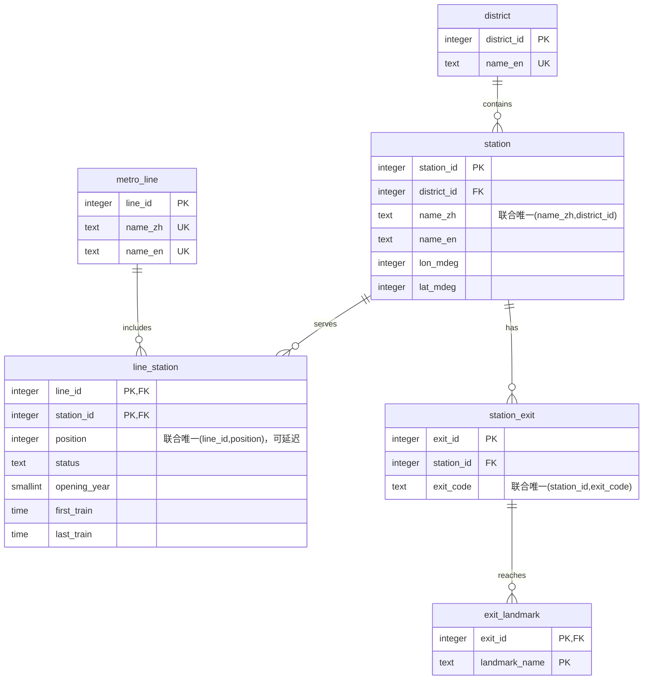

# E-R 图源与数据库关系说明

2026-11-02新增：按Lecture 7课堂表示法绘制的正式概念图、六表映射图及完整设计理由位于[ER_lecture7目录](ER_lecture7/ER设计思路与项目要求对应说明.md)。下方Mermaid保留为关系结构参考，不能混同为课堂概念表示法。

以下为可编辑的逻辑图源，可在支持 Mermaid 的软件中查看。正式报告配图和说明见 [Report Task 1–2](report-task1-task2.md)，其中包含课程表示法概念图和 DataGrip 从 PostgreSQL 实库导出的关系图。

所有实体均参与至少一条外键关系。FK方向：exit_landmark→station_exit→station→district，line_station→station和metro_line，无环。每表均有非自增ID的必填业务字段；关联表的复合主键本身提供非自增业务唯一性。

DataGrip：连接作业库→执行 import.sql→刷新 project1 schema→选择该 schema→Show Diagram（部分版本称 Show Visualization）→调整布局并导出 PNG。完整字段定义以 `sql/schema.sql` 为准。
