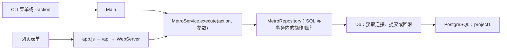

# Java 应用构建与车站增删改查

**新增、修改、删除车站的 SQL 在 Java 源码里。** 从 [MetroRepository.java](../app/src/main/java/metro/MetroRepository.java) 搜索 `saveStation` 和 `deleteStation`，就能看到程序实际交给 PostgreSQL 的 `INSERT`、`UPDATE` 和 `DELETE`。车站搜索的 `SELECT` 主要在 [MetroService.java](../app/src/main/java/metro/MetroService.java) 的 `stations` 方法中。

## 1. 从源码构建可运行的 JAR

本项目的 Java 入口是 `metro.Main`。网页由 JDK 自带的 HTTP 服务器提供，浏览器执行原生 HTML、CSS 和 JavaScript。Java 通过 PostgreSQL JDBC 驱动访问数据库。Windows 下用项目提供的 PowerShell 脚本即可构建。

```powershell
Set-Location 'D:\DB_project1\Project1_v0'
java -version
javac -version
.\scripts\build.ps1
```

需要 JDK 17 或更新版本。可以用 `javac -version` 确认编译器可用。构建过程由 [build.ps1](../scripts/build.ps1) 定义。

| 步骤 | 输入 | 输出与用途 |
|---|---|---|
| 准备 JDBC 驱动 | `app/lib/postgresql-42.7.14.jar` | 构建脚本校验 SHA-256。驱动缺失时从 pgJDBC 下载。 |
| 编译源码 | `app/src/main/java` 下的 `.java` 文件 | `javac --release 17 -encoding UTF-8` 生成 `app/build/classes/metro/` 下的 `.class` 文件。驱动 JAR 在编译类路径上。 |
| 复制资源 | `app/src/main/resources/web/` 和 `sql/q*.sql` | 放入 `app/build/classes/web/` 和 `app/build/classes/sql/`，运行时可从 JAR 内读取。 |
| 创建清单并打包 | 编译产物和资源 | 生成 `app/build/metro.jar`。清单指定 `Main-Class: metro.Main`，并以 `Class-Path: ../lib/postgresql-42.7.14.jar` 指向外置驱动。 |
| 可选编译测试 | `app/src/test/java` | `build.ps1 -Tests` 额外生成 `app/build/test-classes/`。实际执行测试用 `test.ps1`。 |

这里的 `--release 17` 让产物面向 Java 17。JAR 中包含应用类和资源，运行时还需保留相对于 JAR 的 `../lib` 目录和驱动文件。可以用下面的命令检查实际产物。

```powershell
jar tf app/build/metro.jar | Select-String 'metro/Main.class|web/index.html|web/app.js|sql/q7.sql'
java -jar app/build/metro.jar --help
```

项目也提供 [Maven 配置](../app/pom.xml)。如果已经安装 Maven，可从项目根目录运行 `mvn -f app/pom.xml package`，产物为 `app/target/metro-project1-1.0.0.jar`，运行时驱动在 `app/target/dependency/`。本文后续示例使用 PowerShell 构建产物。

## 2. 启动 CLI 和 Web

数据库服务与 Java 应用是两个进程。构建 Java 不需要数据库在线。运行正常业务时，`Main` 会先调用 `stats` 检查连接并查询项目表。默认地址是 `127.0.0.1:55437/metro_test`，数据库角色是 `metro`。连接参数优先取 `METRO_DB_URL`、`METRO_DB_USER`、`METRO_DB_PASSWORD`，其次取 `config/db.properties`，最后用内置默认值。若 `psql` 未加入 PATH，启动数据库时可传入 `-PgBin 'D:/labkey/apps/postgresql-12.6/bin'`。 [Config.java](../app/src/main/java/metro/Config.java)

```powershell
# 数据库服务停止时，先启动它。
.\scripts\local-db.ps1 -Action start

# 进入交互式 CLI。
.\scripts\run.ps1

# 在另一个终端启动 Web，然后访问 http://127.0.0.1:8088/。
.\scripts\run.ps1 -Web
```

[run.ps1](../scripts/run.ps1) 在 JAR 缺失或传入 `-Rebuild` 时调用构建脚本。改了 Java 或网页资源后，可退出旧 CLI（输入 `0`）或停止旧 Web，再用 `run.ps1 -Rebuild` 启动新版。Windows 上，正在运行的进程可能锁定 JAR。若报文件被其他进程使用，要先关闭使用该 JAR 的 CLI 和 Web 进程。

初始化空库时执行 `local-db.ps1 -Action import`。它会执行 `sql/import.sql`，重建 `project1` 的六张表并写入原始数据。重新导入会清除这六张表里的后续修改。

## 3. 从界面操作追到数据库



以「新增站点」为例，CLI 菜单第 2 项把输入整理成参数，传给 `execute("stationAdd", params)`。网页表单由 `app.js` 将同一个操作名和参数发送到 `POST /api`，`WebServer` 校验请求后调用同一个 `execute`。业务层读取区编号、中英文站名及可选坐标，然后调用 `saveStation(null, ...)`。传入 `null` 的 ID 表示新增，传入已有 ID 表示修改。 [CLI 入口](../app/src/main/java/metro/Main.java) · [网页表单](../app/src/main/resources/web/app.js) · [HTTP 接口](../app/src/main/java/metro/WebServer.java) · [业务分发](../app/src/main/java/metro/MetroService.java)

`Db.open()` 连接后设置 `search_path TO project1,pg_catalog`，因此 Java 里的 `INSERT INTO station` 指的是 `project1.station`。在 DataGrip 控制台手工试写 SQL 时，直接用 `project1.station` 更容易确认目标。

### 按操作名定位 SQL

| 操作 | action | 到哪里找 |
|---|---|---|
| 搜索车站 | `stations` | `MetroService.stations`，按编号精确匹配，或在名称、行政区内做包含匹配 |
| 车站详情与出口 | `stationDetail` | `MetroService.stationDetail`，查车站、线路关系、出口与地标 |
| 新增车站 | `stationAdd` | `MetroRepository.saveStation` 中 `id == null` 的 `INSERT ... RETURNING` |
| 修改车站 | `stationUpdate` | `MetroRepository.saveStation` 中的 `UPDATE ... WHERE station_id=?` |
| 删除物理车站 | `stationDelete` | `MetroRepository.deleteStation`，处理所有线路关系后删除车站 |
| 将车站加入线路 | `lineInsert` | `MetroRepository.insertStations`，后移站序并插入 `line_station` |
| 将车站移出一条线路 | `lineRemove` | `MetroRepository.removeStation`，删除一条线路关系并重排该线站序 |
| 新增、修改、删除线路 | `lineAdd` / `lineUpdate` / `lineDelete` | `MetroRepository.saveLine` / `deleteLine` |
| 数据核验 Q1–Q7 | `q1` 到 `q7` | `MetroService.resource` 从 JAR 读取 `/sql/q1.sql` 到 `/sql/q7.sql` |

[业务查询源码](../app/src/main/java/metro/MetroService.java) · [写入与站序源码](../app/src/main/java/metro/MetroRepository.java)

## 4. 新增和修改车站执行了什么

新增时，应用把五个输入值按顺序绑定给五个问号。

```sql
INSERT INTO station(district_id, name_zh, name_en, lon_mdeg, lat_mdeg)
VALUES (?, ?, ?, ?, ?)
RETURNING station_id
```

1. `station_id` 由 PostgreSQL 的 identity 列生成。
2. `RETURNING station_id` 把新编号随同一条 SQL 返回。Java 用 `executeQuery()` 读取结果，因此这里的 `query(...)` 执行的是带返回行的 `INSERT`。
3. `district_id` 必须引用一个已有行政区。同一行政区内不能重复使用同一个中文站名。经纬度要一起为空或一起有值。 [六表约束](../sql/schema.sql)

修改时使用已有编号定位一行。实际实现检查影响行数等于 1，再查回编号。

```sql
UPDATE station
SET district_id = ?, name_zh = ?, name_en = ?, lon_mdeg = ?, lat_mdeg = ?
WHERE station_id = ?
```

`?` 是 JDBC 的参数位置。底层用 `connection.prepareStatement(sql)` 创建预编译语句，再用 `setObject(i + 1, args[i])` 绑定实际值。参数保持数据身份，所以英文站名 `Bao'an` 可以直接传入 Java，用户输入里的引号也不会改变 SQL 的结构。直接在 DataGrip 运行本文 SQL 时，需要填实际值。 [参数绑定实现](../app/src/main/java/metro/MetroRepository.java#L15)

## 5. 删除车站为什么有多条 SQL

一座物理车站可以被多条线路引用。应用用一个写事务完成以下步骤。

1. `topologyLock(c)` 调用 `pg_advisory_xact_lock(307,1)`，串行化线路编排相关写入。随后把站序唯一约束 `line_station_position_uq` 延迟到事务结束时检查。
2. `SELECT station_id FROM station WHERE station_id=? FOR UPDATE` 锁定要删除的车站，并确认它存在。随后查出受影响线路，按编号顺序锁定这些线路的主表行。
3. `DELETE FROM line_station WHERE station_id=?` 移除该站在所有线路里的关系。`line_station.station_id` 的外键是 `ON DELETE RESTRICT`，所以要在删除车站前先处理这些关系。
4. 对每条受影响线路运行 `compact(c, lineId)`。它用 `row_number() OVER (ORDER BY position)` 计算从 1 开始的新站序，再用 `UPDATE ... FROM` 写回。例如原来是 A=1、B=2、C=3，删 B 后变成 A=1、C=2。
5. `DELETE FROM station WHERE station_id=?` 删除物理车站。数据库根据两个 `ON DELETE CASCADE` 外键，依次删除该站的 `station_exit` 和这些出口的 `exit_landmark`。

这些语句共用 `Db.transaction(false, ...)` 打开的连接。执行前关闭自动提交，全部成功后调用 `commit()`，发生 SQL 或运行时异常则 `rollback()`。所以即使最后一步失败，已经移除的线路关系和更新过的站序也会一起回滚。 [删除实现](../app/src/main/java/metro/MetroRepository.java#L66) · [事务实现](../app/src/main/java/metro/Db.java#L22)

### 与「从线路移出」的区别

`lineRemove` 按 `line_id` 和 `station_id` 删除 **一条 `line_station` 关系**，然后重排那条线路。站点资料、出口和其他线路的关系仍可查询。反过来，`lineInsert` 把已经存在的车站编入指定位置，先将后续站序整体加上本批插入数，再按用户给出的顺序写入关系表。 [线路操作实现](../app/src/main/java/metro/MetroRepository.java#L86)

## 6. 在 DataGrip 验证基础 SQL

下面是在专用测试库观察 `INSERT`、`UPDATE` 和 `DELETE` 的完整示例。示例车站没有加入任何线路。最后的 `ROLLBACK` 会撤销这次演练的表数据变化，但已分配的自增编号可能留下空号。请在同一个控制台按顺序执行整段。

```sql
BEGIN;

INSERT INTO project1.station(district_id, name_zh, name_en, lon_mdeg, lat_mdeg)
VALUES (
    (SELECT district_id FROM project1.district WHERE name_en = 'Futian'),
    'JDBC讲解演练站', 'JDBC Walkthrough Station', NULL, NULL
)
RETURNING station_id, name_zh;

UPDATE project1.station
SET name_en = 'JDBC Demo Station'
WHERE name_zh = 'JDBC讲解演练站'
  AND district_id = (SELECT district_id FROM project1.district WHERE name_en = 'Futian')
RETURNING station_id, name_en;

DELETE FROM project1.station
WHERE name_zh = 'JDBC讲解演练站'
  AND district_id = (SELECT district_id FROM project1.district WHERE name_en = 'Futian')
RETURNING station_id;

ROLLBACK;
```

想看应用完整的删除流程，可以在测试库通过 CLI 或 Web 新增一个站，将它加入测试线路，再从界面删除该站。删除前后用下面的查询对比站序，替换 `Demo Line` 为实际的线路英文名。

```sql
SELECT ls.position AS "Num", s.station_id, s.name_zh
FROM project1.line_station AS ls
JOIN project1.metro_line AS l USING (line_id)
JOIN project1.station AS s USING (station_id)
WHERE l.name_en = 'Demo Line'
ORDER BY ls.position;
```

网页的「SQL 查询」使用专用只读连接。上面的写入演练应在 DataGrip 或 `psql` 中用测试库的写入账号执行。 [SQL 查询入口实现](../app/src/main/java/metro/SqlConsole.java)

## 7. 为什么有些 SQL 单独放文件

| 位置 | 执行时机 |
|---|---|
| `sql/schema.sql`、`sql/import.sql` | 搭建或重置测试库。前者定义表和约束，后者包含建表、初始数据及索引等。 |
| `sql/q1.sql` 到 `sql/q7.sql` | Java 运行数据核验操作时，从 JAR 的资源目录读取，按需绑定参数。 |
| `sql/queries.sql` | DataGrip 答辩用。示例参数已经填好，方便直接执行。 |
| `MetroRepository.java`、`MetroService.java` | 用户执行应用操作时，由 Java 选择 SQL 并绑定数据。多条写入语句按业务顺序放在同一个事务里。 |

读代码时可以用「界面上的操作名 → `MetroService.execute` 的 `case` → 对应方法」定位。改了 Java 里的业务 SQL，重新构建并启动应用就会加载新代码。只有表结构或初始数据的变化才需要另外处理数据库的迁移或重建。
