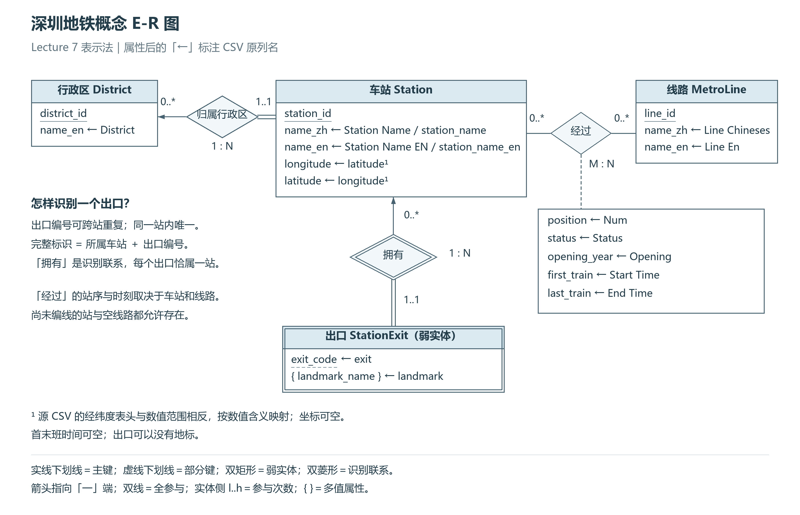
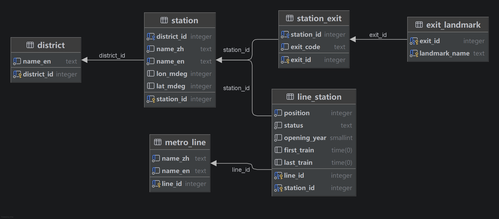

# Report 配图与技术说明：Task 1–2

供组员写报告时核对和引用。课程要求的姓名、学号、实验班和真实贡献比例由组员填写。

## Task 1：概念 E-R 图

绘图工具：Python 3、Pillow 及自编 SVG 绘图脚本。矩形和菱形分别表示实体和联系，主键用实线下划线，箭头指向一对多中的「一」端。一个区可有多站，每站恰属一区；车站与线路是多对多，站序、状态、开通年和时刻描述某个站在线路上的情况。车站出口依赖所属车站识别：图中用双矩形、双菱形和部分键虚线下划线表示，出口侧双线表示每个出口必须有所属车站。出口可对应多个地标名。两份 CSV 的原列名标在相应属性旁。

## Task 2：关系设计

图由 DataGrip 2026.2.5 连接实际 PostgreSQL 验证库后，从 `project1` 生成并导出。各表显示列名和类型，箭头表示引用方向。

概念层的「所属车站＋出口编号」在关系层保留为唯一候选键，同时使用整数 `exit_id` 作为代理主键，让地标关系只存一个整数来引用出口。关系图中的外键为概念联系转表后的实现。

| 表 | 含义与字段 |
|---|---|
| `district` | 行政区：`district_id` 为内部编号，`name_en` 是唯一英文区名。 |
| `station` | 物理车站：`station_id` 为站点编号，`district_id` 表示所属区，`name_zh/name_en` 为中英文名，`lon_mdeg/lat_mdeg` 为可空的千分度经纬度。中文名与所属区组合唯一。 |
| `metro_line` | 线路或独立分期：`line_id` 为线路编号，`name_zh/name_en` 分别保存唯一的完整中英文线路名。 |
| `line_station` | 线路经过车站：`line_id/station_id` 组成主键；`position` 是同线路唯一站序（CSV 的 `Num`）；`status`、`opening_year`、`first_train/last_train` 是该站在此线的状态、开通年和可空首末班时间。 |
| `station_exit` | 车站出口：`exit_id` 为内部编号，`station_id` 指定所属站，`exit_code` 表示该站内的出口编号。 |
| `exit_landmark` | 出口关联的一个地标名称：`exit_id/landmark_name` 组成主键，同名地标可出现在不同出口。 |

- **1NF**：每个字段为原子值；一个出口只存一个代码，多个地标拆成多行。
- **2NF**：站名和线路名各自存储；站序、状态、年份和时刻依赖完整的 `(line_id, station_id)`，也可由另一候选键 `(line_id, position)` 决定。地标关系没有非键属性。
- **3NF**：车站表不冗余区名，编排表不冗余站名或线路名，地标关系不冗余所属站与出口代码。按当前业务语义，表中非键字段不经其他非键字段间接依赖候选键。

六表均在外键关系中，引用方向为 `exit_landmark → station_exit → station → district`、`line_station → station/metro_line`，无环。答辩和提交使用 [纯建表附件](../sql/schema.sql)：文件只含六条 `CREATE TABLE`。如需独立执行，先在专用空库另行执行 `CREATE SCHEMA project1;`。加载完整数据时直接执行 [import.sql](../sql/import.sql)。
