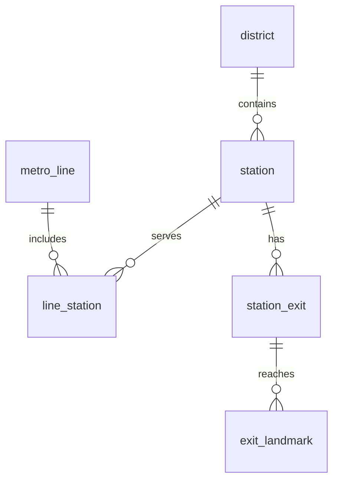

# CS307 Project 1：项目要求总结与技术实现路线（v0）

编写日期：2026-10-24。适用项目：CS307 Fall 26 Project 1，深圳地铁数据管理。

## 1. 报告范围与结论

本文件是开发前的需求分析与技术方案，不是已完成系统的实验报告，也不是可以直接提交的课程最终报告。课程最终报告另须整理为规定页数的 PDF，补充真实组员信息、分工、实际截图和实测数据。本次未连接数据库、未导入或修改现有数据库，未测得查询延迟或数据库空间占用。

依据为本目录上一级的 `CS307-Fall26-project1.pdf`（8 页），以及 `Archive.zip` 内的两份原始 CSV。下文以“要求”“已核验”“建议”“待确认”区分课程规定、实际数据事实、方案选择和尚未确定的业务口径。PDF 中的操作要求作为被分析的课程要求，不构成执行数据库清理、提交作业等操作的授权。

**推荐路线：PostgreSQL + 六张核心关系表 + 少量针对性 B-tree 索引 + 单事务批量 INSERT 导入 + Java/JDBC 分层程序及命令行入口。** 先确保 439 站、29 线、数据完整和 Q1–Q7 正确，再完成 CRUD、线路位置维护，最后做路径、地标路线、票价与界面。

优化目标是正确性约束下的时间与空间平衡。两份 CSV 只有 567 条线路站点记录和 1,276 条出口记录；这个规模下，索引、连接和事务设计应保持简单。无法同时无条件做到所有查询最快、全部存储最小、任意更新成本最低，应按答辩工作负载比较方案。

## 2. 项目要求与交付清单

### 2.1 通用要求

| 项目 | PDF 要求及注意事项 |
|---|---|
| 组队 | 同一实验课的两人组；独立完成；两人提交一份报告；Project 2 沿用组队，不得更换 |
| 截止时间 | **2026-11-15 23:55，北京时间 UTC+8**，提交至 bb；迟交零分（第 8 页） |
| 报告格式 | PDF；文字严谨、组织清楚、图示易读；不得抄袭网络或同学的句子和图 |
| 页数 | 原文写“between 5 and 7”，又写“only or less than 5”会扣分，措辞冲突；**建议做 6–7 页**，避免正好 5 页的争议 |
| 组员说明 | 姓名、学号、实验课、具体任务和贡献百分比；每项任务必须落实到成员，否则该任务不计分 |
| 数据依据 | 两份项目 CSV 优先于外部资料，不得用网络信息改写既有数据 |
| 附件 | SQL 与源码等按任务分目录，压缩为 ZIP；DDL 是独立文件，不贴满最终报告 |
| 演示 | 现场使用导入后的数据；准备 DataGrip 查询与所有功能的命令行提示，图形界面不能替代命令行要求 |

### 2.2 评分与验收

| 任务 | 分值 | 必须准备的成果 |
|---|---:|---|
| Task 1：概念 E-R 图 | 20% | 软件绘制、遵守标准 E-R 表示法；报告中放截图并注明绘图软件；不接受手绘 |
| Task 2：数据库设计 | 20% | PostgreSQL 表结构；数据库客户端生成的关系图截图；逐表逐字段解释；单独的全部 CREATE TABLE DDL |
| Task 3.1：导入过程说明 | 5% | 列出所有准备/导入脚本与 AI 工具：名称、类型、作者/使用者、作用、运行方式；LLM 按实际记录模型，不编造 |
| Task 3.2：一键导入 | 5% | 单独完整 `import.sql`；含全部建表、约束、必要索引和**全部 INSERT 数据**；开头确定性 DROP 清理；可重复执行；尽量快 |
| Task 3.3：准确性 | 20% | 准确性 15% + 预先准备 SQL 并按时完成 5%；Q1–Q7 在 DataGrip 演示；原文亦要求把查询准备在报告中 |
| Task 4：基本功能 | 15% | 站点与线路增删改查；一个或多个站点插入线路指定位置；站点移出线路 |
| Task 4：高级功能 | 10% | 两站路径；两个地标间线路；票价；界面；单程序运行与合理分层 |
| Task 4：展示 | 5% | 系统熟悉程度、表达和时间管理 |

Task 3 合计 30%，Task 4 合计 30%，总计 100%。高级部分未给每个子项单独分值，不能自行假定每项固定 2%。

### 2.3 数据库约束

**硬要求：**所有数据项基于 CSV；符合 1NF、2NF、3NF；每表有主键；每表参与外键关系（可以引用其他表，也可以被引用）；无外键方向环；字段类型适当。

**原文 “Try to complete” 加强要求：**每表至少有一个非自增 ID 的 NOT NULL 字段；自增 ID 之外有业务 UNIQUE 约束；容易扩展。建议全部做到，联合业务 UNIQUE 也应在报告中明确解释。

## 3. 原始数据核验：先解决身份和语义

### 3.1 已核验数据规模

采用 CSV 解析器读取 ZIP 内 UTF-8-SIG 文件，正确处理文件中的异常换行；不使用按换行数计数、不以逗号手工切整行。

| 指标 | 核验结果 | 设计影响 |
|---|---:|---|
| 站点主表数据记录 | 567 | 代表站点在线路上的出现，不是物理站数 |
| 中文站名种类 | 438 | 按中文名去重会少算一站 |
| 英文站名种类 | 437 | 英文名也不能作为全局唯一标识 |
| `(中文站名, District)` 种类 | **439** | 与 PDF Q1 的 439 一致，采用此业务候选键 |
| 完整线路英文名种类 | **29** | 支线、分期延伸线单独保留；不能只抽取数字合并 |
| 行政区 | 10 | 适合小字典表 |
| 线路内 Num | 均从 1 连续至该线最大值，无重复或缺口 | 可直接作为初始线路位置 |
| 运营/在建线路站点记录 | 434 / 133 | 状态属于线路站点关系，不应粗暴归为全站唯一状态 |
| 起止时间缺失 | 各 147 | 缺失置 NULL；不能全填默认 06:00–23:00 |
| 坐标缺失 | 两列各 280 | 不允许用 0 或虚构坐标替代 |
| 出口原始记录 | 1,276 | `(station_name, exit)` 无重复 |
| 有出口数据的中文站名 | 340 | 没有出口记录不代表车站不存在 |
| 空地标记录 | 3 | 保留出口，地标关联数为 0 |
| 多出口组合记录 | 17 | 必须决定组合出口如何原子化 |
| 按下述规则展开的出口 | 1,304 | 无重复站点出口键，取决于固定展开规则 |
| 原地标拆分条目 / 不同文本 | 3,203 / 2,872 | 分隔符为全角逗号“，” |
| 出口展开后的出口地标关联 | 3,271 | 不可误把数量增长当成重复导入 |

两份 CSV 均无完全相同的重复整行。原始文件 SHA-256 及机器可读核验结果另见 `数据核验摘要.json`。

### 3.2 必须处理的五类问题

**一、同名站需要区分。**“梨园 / Liyuan”在 Line 3 的 Longgang（Operation，2024）与 Line 17 Phase 1 的 Luohu（Construction，2028）各有一站。不得合并，否则 Q1 会变为 438，并产生错误换乘。“塘坑 / Longgang”和“汤坑 / Pingshan”都叫 Tangkeng。站点业务键采用 `(name_zh, district_id)`；英文名建立普通索引，查询可能返回多条。交互程序要求用户进一步选择行政区或线路。

**二、出口文件缺少行政区。**出口文件有“梨园”的 B、C 两条记录，却无区/线路。两个候选站不能仅凭名字自动连接，更不能同时连到两站。建议在独立映射配置中显式指定这两行归到 Longgang 的梨园：它是同名候选中唯一运营站，且地标含“龙岗中心医院”“龙岗中学”。这是**有数据内证据的方案假设，仍应向教师确认**，不把推断描述成 CSV 明示事实。其余 339 个有出口的中文站名在本数据中可唯一匹配；未匹配或多匹配记录一律输出核验错误，不静默丢弃。

**三、时刻、年份和状态依赖线路。**同一换乘站可能不同线路开通年份不同，例如世界之窗 Line 1=2004、Line 2=2010；部分站同时出现在运营线和在建线。将这些字段放入 `line_station`。Q3 按“存在至少一条 Operation 记录的物理站”计数，使用 EXISTS 消除换乘重复。

**四、坐标表头疑似颠倒。**CSV 的 `latitude` 范围为 113.720–114.450，`longitude` 范围为 22.477–22.880，前者超出纬度合法范围。建议原文件不改、核验日志保留原列名；数据库明确映射 `lon_mdeg = CSV.latitude × 1000`、`lat_mdeg = CSV.longitude × 1000`，用十进制定点运算转换。本数据最多三位小数，可用两个 integer 精确保留。此映射在最终报告披露，并请教师确认。坐标只辅助展示，不能据此计算真实票价或用坐标重建已有站序。相同中文站名已有坐标中未发现非空值互相冲突，但填充时仍必须按完整站点身份分组。

**五、出口和地标的拆分规则。**

- 出口枚举按“、”或“/”拆分，如 `3a、3b、5` → 三个代码，`E1/E2` → 两个代码；保留大小写，不凭想象改名。
- 仅对明确符合整数范围的 `2-6号`、`8-11号` 等展开，保留“号”后缀；其他含连字符的代码不自动当范围。
- 每个展开后的出口关联原组中的每个地标。这表示原始文件的组级关联，不证明每个出口实地均能到达所有地标；保存原行映射，便于检查和调整口径。
- 地标只按本数据明确使用的“，”拆分并去掉两端空白。不能对所有标点统一切割，例如学校、医院正式名称内部标点可能有意义。
- “暂停服务”等异常描述仍保留来源信息并列入核验清单，不静默改成某个地点；空地标不制造空字符串关联。

展开出口更贴合第一范式与物理出口计数，但题目未明确组合出口计数口径。答辩前确认；如果教师要求按原始出口组计数，依据原行映射另给查询，不能在同一指标下混用两种结果。Q5 的 Line 1 最大出口数在两种口径下均为 10。

## 4. 架构与方案取舍

本节均为建议，尚非用户指定的技术选型。既有 `db-and-file` 和 `loader-code` 是 Java/JDBC 课程示例，以电影数据为例；可复用分层与事务思路，但不能视为已实现地铁系统，也不能照抄其导入逻辑。

| 路线 | 优点 | 代价与结论 |
|---|---|---|
| 原 CSV 宽表直接导入 | 初期简单、少连接 | 站点/线路信息重复，组合字段难查，CRUD 易不一致，不满足项目范式目标；排除 |
| **六表关系模型，SQL 处理过滤聚合，程序按需构图** | 原子化、少重复、约束清晰；数据库和程序都容易演示 | 有少量连接；本规模成本低，推荐 |
| 更多字典表、永久邻接表、全站对路径缓存 | 某些高频查询更省计算 | 维护复杂、更多行头与索引；几百站不值得预先承担；测量后再决定 |

建议 Java 17 + Maven + JDBC（先确认教学机环境），入口统一为一个程序。架构：CLI/可选 Web 页面 → Service → Repository（参数化 SQL）→ PostgreSQL。Importer 独立生成 SQL 文件；路由算法独立服务。保留一份配置读取数据库连接，密码从环境或本地未提交文件提供。已发现 psql 客户端路径包含 `postgresql-12.6`，这**不能证明实际数据库服务版本**；第一阶段必须执行 `SELECT version()` 后按实际服务版本选择兼容写法，不将最新版特性当作前提。

先做完善 CLI。时间足够再使用同一 Service 提供简洁网页，避免另写一套业务逻辑。无需额外引入 Redis、图数据库、GIS 扩展、微服务或分库分表。

## 5. 六张核心表及字段设计

以下给出可落实到 DDL 的逻辑规格；所有 ID、FK、业务列的约束需在正式 `schema.sql` 写全。`NN` 表示 NOT NULL。ID 建议 `integer GENERATED BY DEFAULT AS IDENTITY`；若导入时显式写入稳定 ID，导入末尾必须将 identity 序列同步到实际最大 ID，防止后续新增碰撞。程序新增使用 `INSERT ... RETURNING id`，不用 `MAX(id)+1`。

### 5.1 字段字典

| 表 | 字段、类型与含义 | 键与约束 |
|---|---|---|
| `district` | `district_id integer`；`name_en text NN`（CSV District） | PK district_id；UNIQUE name_en；非空白检查 |
| `station` | `station_id integer`；`district_id integer NN`；`name_zh text NN`；`name_en text NN`；`lon_mdeg integer NULL`；`lat_mdeg integer NULL` | PK station_id；FK district_id→district；UNIQUE(name_zh,district_id)；经度 ±180000、纬度 ±90000；建议坐标成对为空或成对非空 |
| `metro_line` | `line_id integer`；`name_zh text NN`（Line Chineses）；`name_en text NN`（Line En） | PK line_id；两个名称分别 UNIQUE；不合并 Phase/Branch；非空白检查 |
| `line_station` | `line_id integer NN`；`station_id integer NN`；`position integer NN`；`status text NN`；`opening_year smallint NN`；`first_train time(0) NULL`；`last_train time(0) NULL` | PK(line_id,station_id)；两个 FK；UNIQUE(line_id,position) **DEFERRABLE INITIALLY IMMEDIATE**；CHECK(position>0)；status IN ('Operation','Construction')；年份合理范围 1900–2200 |
| `station_exit` | `exit_id integer`；`station_id integer NN`；`exit_code text NN`（原子出口代码） | PK exit_id；FK station_id→station；UNIQUE(station_id,exit_code)；非空白检查 |
| `exit_landmark` | `exit_id integer NN`；`landmark_name text NN`（单个地标文本） | PK(exit_id,landmark_name)；FK exit_id→station_exit；该复合主键即非自增业务唯一性；非空白检查 |

不强制首班时间小于末班时间，以免将未来跨午夜时刻拒绝。不额外保存“整站开通年”“整站状态”“总出口数”“某线总站数”等可推导指标。

`line_station` 中的年份、状态、时刻必须逐行保存，**不能**从全站最早年份、线路默认时刻反推所有记录。没有时刻的运营站也不能自动变为在建站。

### 5.2 为何不单独建 landmark 表

当前地标只有名称，没有其他独立属性。`exit_landmark(exit_id, landmark_name)` 是原子的集合关系，没有非键属性引起传递依赖，满足 3NF。拆出 `landmark(id,name)` 并非满足第三范式的必要条件。

原拆分条目 3,203 次名称出现，其 UTF-8 名称内容合计 61,807 字节，不同文本 2,872 个、56,114 字节，字典化仅减少 5,693 字节的重复文本内容；却新增 2,872 行的元组开销、ID、主键和唯一索引，同时关联表仍需保存对应 ID。出口展开会稍改这些数值，但不改变“文本重复较少”的结论。**不能因此声称全部方案已实测更小**：整库包括行头、对齐、索引页等，最终用实际数据库量测。

未来地标需要地址、类型、坐标时，再迁移为 landmark 实体及关联表。当前用精确文本名称检索即可；同名地标并不代表真实世界同一地点，界面同时显示所属车站/出口让用户选择。

### 5.3 3NF 与外键图

函数依赖：district_id→行政区名称；station_id→名称/行政区/坐标；line_id→线路名称；(line_id,station_id)→站序/状态/开通年/时刻；exit_id→站点/代码。出口地标由整个复合键唯一识别，无非键列。站点表不重复行政区文本，关联表不重复线路名称，避免部分依赖和传递依赖。



该图只用于本方案解释，最终 Task 1 另绘符合课程标准的概念 E-R 图，明确基数、键、属性；Task 2 仍需从实际数据库客户端生成并截图。

FK 方向为：exit_landmark→station_exit→station→district；line_station→station；line_station→metro_line。拓扑无环，六张表均被引用或引用别表。实体表无需为了“每表参与外键”硬加反向 FK。数据库外键图无环也不意味着地铁线路不能成环，两者是不同约束。

删除建议：station→station_exit→exit_landmark 可使用 ON DELETE CASCADE；line_station 对 station、metro_line 使用 ON DELETE RESTRICT，由 Service 在一个事务中先删关联、维护站序后再删实体；district 被站点引用时 RESTRICT。界面明确显示删除影响并按用户操作执行。

## 6. 数据类型、索引与空间优化

### 6.1 类型选择

- 使用 integer ID，而不是无必要的 bigint、UUID；线路位置也用 integer，避免站序更新和中间运算范围问题。
- 年份用 smallint，时刻用 time(0)，不以 text 反复解析；空值保持 NULL。
- 文字使用 text 加非空白/业务约束。缩短 varchar 上限通常不会压缩实际短文本；char(n) 还会补空格，不应以此作为压缩手段。[PostgreSQL 字符类型说明](https://www.postgresql.org/docs/current/datatype-character.html)
- 状态暂用 text + CHECK，只有 567 条记录时字典表收益有限，避免为了两种值再增加表和连接。若采用 PostgreSQL ENUM，也应说明修改枚举值的迁移成本。
- 坐标使用千分度整数是针对当前三位小数数据的选择；未来精度变化先校验并迁移，不悄悄截断。计算显示时除以 `1000.0`。

### 6.2 最小索引集合

| 索引 | 提供方式 | 服务场景 |
|---|---|---|
| 各表 PK、业务 UNIQUE | 约束自动建立索引 | 完整性、精确身份查找；不要重复建同列索引 |
| line_station(line_id,position) | 上述可延迟 UNIQUE | Q7 两次站序定位、读取整条线路、邻接推导 |
| line_station(station_id,line_id) | 显式普通 B-tree | 站点反查所属线路、状态 EXISTS、站点关联删除 |
| station(name_en) | 显式普通 B-tree | 英文站名检索，再与指定线路组合消歧 |
| exit_landmark(landmark_name text_pattern_ops) | 显式普通 B-tree | Q6 的固定前缀 LIKE；保留正常输出排序 |

`station_exit` 的 UNIQUE(station_id,exit_code) 已覆盖按站点取出口；exit_landmark 的 PK 以 exit_id 开头已覆盖出口关联查询；line_station 的 PK 以 line_id 开头已覆盖线路 FK。PostgreSQL 不会自动为每个引用端 FK 创建索引，必须检查现有索引的左侧列是否覆盖需求；station 的 district_id 索引列为可选项，439 站时未必值得新增。

中文前缀查询在非 C 排序环境下通常需要适当 pattern operator class；普通 B-tree 并不保证 `LIKE '塘朗%'` 使用索引。采用确定性文本排序并检查实际计划，避免临时改全库排序规则。[PostgreSQL 索引类型说明](https://www.postgresql.org/docs/current/indexes-types.html)

暂不建状态单列索引、开通年份单列索引、行政区排序索引、GIN/trigram 索引或大型 INCLUDE 覆盖索引。Q3/Q4 的数百行聚合很小；顺序扫描可能比索引更快。`LIKE '%关键词%'` 是另一种工作负载，不能声称当前前缀索引也能解决。

## 7. 导入路线：独立、完整、可复现

### 7.1 离线生成流程

1. 读取原始 CSV 并校验表头、编码、列数、行数和 SHA-256；不更改输入文件。
2. 构造区、站点、线路字典；站点键固定为中文名+行政区；按确定排序分配导入 ID。
3. 建立显式的重名出口映射，解析出口与地标，生成每个目标对象到原文件行号的映射。原行号记录按 CSV 数据行号计算，不按物理换行号。
4. 将每条主表记录转为 line_station；坐标按站点合并非空值，遇到不同非空值报错；空时刻/坐标置 NULL。
5. 验证目标计数、键唯一、FK 可解析、站序连续，以及每条源记录均能回溯。输出独立核验 JSON、映射 CSV/JSON，不为审计原文额外创建孤立数据库表。
6. 同一份模型定义生成 `schema.sql` 和完整 `import.sql`，防止二者表结构漂移。SQL 文本用正确字面量转义，英文 `Xin'an`、`Children's Palace` 必须成为合法字符串；交互操作仍使用绑定参数。

### 7.2 import.sql 的执行顺序

```text
BEGIN
  → 按依赖顺序 DROP TABLE IF EXISTS（仅本项目的明确表名）
  → CREATE TABLE：实体→关联，包含完整约束
  → 多行 INSERT：district→station/metro_line→line_station/station_exit→exit_landmark
  → 建必要的额外查询索引
  → 同步各 identity 序列
  → CREATE OR REPLACE FUNCTION get_station_n_neighbor
  → DO 块断言：数量、数据完整、站序等，不符合则抛错
  → ANALYZE 六张表
COMMIT
```

使用独立 `project1` schema 并对对象加限定名，开发库和展示库隔离；避免 DROP SCHEMA CASCADE 波及其他项目。若已有 Q7 函数依赖待删表，先按准确参数签名 DROP 该函数，再删表；由生成器保持一致。最终脚本开头的清理满足课程要求，但本次只提出方案，未执行任何清理。

全流程单事务，失败则回滚；重复运行应在相同初始数据下恢复相同内容和计数。一次成功后进行两次完整重跑验证，而非仅用 ON CONFLICT DO NOTHING 掩盖漏数。

### 7.3 导入速度与要求的边界

课程明确要求脚本包含全部 INSERT，**不能只提交 Python 导入器、COPY 外部路径或依赖客户端的 `\copy`**。正式版采用每批约 300–1,000 行的多值 INSERT，整批只提交一次；普通附加索引在数据插入后创建。主键/唯一约束及外键在本规模下建议一直启用；若后续比较先装载再加约束，必须最终验证约束并在任一失败时回滚。

PostgreSQL 官方一般建议大量导入使用 COPY，并给出批量事务、后建索引和导入后 ANALYZE 等方法；本项目以“包含全部 INSERT”的课程要求优先，COPY 只可作额外基准比较。[PostgreSQL 批量装载建议](https://www.postgresql.org/docs/current/populate.html)

不关闭持久性保障、不使用不受约束的正式业务表、不承诺未经测量的导入耗时。两表数据规模很小，远程网络和 DataGrip 执行模式也可能主导时间。

## 8. Q1–Q7 查询与预期结果

下面是与本方案一致的 SQL 草案。正式实现需加 project1 schema 限定或受控 search_path，并在实际 PostgreSQL 验证；当前未作为已运行结果交付。固定示例中的字符串在应用内改为绑定参数。

### Q1 / Q2：物理站点、完整线路

```sql
SELECT count(*) AS station_count FROM station;     -- 439
SELECT count(*) AS line_count FROM metro_line;    -- 29
```

不能对 line_station 计数当站点数，也不能把延伸线折叠成主线。

### Q3：按区统计运营站

```sql
SELECT d.name_en AS district, count(*) AS cnt
FROM station s
JOIN district d ON d.district_id = s.district_id
WHERE EXISTS (
    SELECT 1 FROM line_station ls
    WHERE ls.station_id = s.station_id AND ls.status = 'Operation'
)
GROUP BY d.district_id, d.name_en
ORDER BY d.name_en COLLATE "C";
```

CSV 独立核验与 PDF 示例一致：Bao'an 58、Dapeng 1、Futian 52、Guangming 24、Longgang 70、Longhua 21、Luohu 32、Nanshan 67、Pingshan 16、Yantian 9，合计 **350 个运营物理站**。Q3 的 Operation 记录共有 434 条，不能直接当作 434 站。当前各区都有运营站；若要求未来零运营站的区也显示，用 LEFT JOIN 并明确统计口径。

### Q4：指定线路分年度开通数量

```sql
SELECT ls.opening_year AS opening, count(*) AS cnt
FROM line_station ls
JOIN metro_line l ON l.line_id = ls.line_id
WHERE l.name_en = 'Line 5'
GROUP BY ls.opening_year
ORDER BY ls.opening_year;
```

Line 5：2011→27，2019→7，2025→3。不得从 station 上拿“全站最早开通年”，也不要自行过滤 Construction，除非题目参数另外要求。

### Q5：出口最多的全部并列站

```sql
WITH counts AS (
    SELECT s.station_id, s.name_en AS english_name, count(e.exit_id) AS cnt
    FROM metro_line l
    JOIN line_station ls ON ls.line_id = l.line_id
    JOIN station s ON s.station_id = ls.station_id
    LEFT JOIN station_exit e ON e.station_id = s.station_id
    WHERE l.name_en = 'Line 1'
    GROUP BY s.station_id, s.name_en
)
SELECT english_name, cnt FROM counts
WHERE cnt = (SELECT max(cnt) FROM counts)
ORDER BY english_name COLLATE "C";
```

结果：Chegongmiao 10、Shenzhen University 10（顺序不影响并列正确性）。先数出口，不连接地标表，以免一个出口有多个地标而重复计数；LEFT JOIN 使用 count(e.exit_id)，避免无出口的站被误算为 1。

### Q6：按单个地标前缀查站点与出口

```sql
SELECT s.name_zh AS chinese_name, d.name_en AS district,
       e.exit_code AS exit, el.landmark_name AS name
FROM exit_landmark el
JOIN station_exit e ON e.exit_id = el.exit_id
JOIN station s ON s.station_id = e.station_id
JOIN district d ON d.district_id = s.district_id
WHERE el.landmark_name LIKE '塘朗%'
ORDER BY s.name_en COLLATE "C", s.station_id,
         e.exit_code COLLATE "C", el.landmark_name COLLATE "C";
```

原 CSV 可核验 6 条：深大丽湖/C/塘朗大厦、深大丽湖/C/塘朗新村、塘朗/D/塘朗村、塘朗/B/塘朗地铁车辆段、塘朗/A/塘朗城、桃源村/D/塘朗山公园，行政区均 Nanshan。组内次序可因确定性次排序略有不同。必须返回完整的单个地标，不是未拆分的整段描述。参数化 LIKE 仍允许通配符；若 UI 声称“字面前缀”，需转义用户输入的 `%`、`_` 与转义符。

### Q7：get_station_n_neighbor 函数

要求函数名和三个参数依次为 `station_name`、`line_name`、`n`。PDF 使用 `SELECT get_station_n_neighbor(...)`，返回**两行单列英文站名，先较小站序、后较大站序；越界的一侧保留 NULL 行**。

建议签名：`get_station_n_neighbor(station_name text, line_name text, n integer) RETURNS SETOF text`，语言 PL/pgSQL。函数逻辑：

1. 校验 n 不为 NULL、不小于 0；建议 n=0 返回当前站两行并在帮助中写明。非法参数报清楚错误。
2. 用 metro_line.name_en 查 line_id，再把英文站名与该线路关系联合定位。0 个结果时报“站点不在此线路”，多个结果时报歧义；不任意 LIMIT 1。
3. 以定位得到的 position 计算 position−n、position+n；中间运算提升 bigint，避免极大 n 引起 integer 溢出。
4. 依次 RETURN QUERY 两个标量子查询，各自通过 UNIQUE(line_id,position) 查站名。标量子查询无记录自然产生 NULL，确保总是两行。
5. 调用方要求稳定行次序时采用 `WITH ORDINALITY` 并 ORDER BY ordinality；展示同时覆盖 PDF 的原始调用方式。

预期：

```text
get_station_n_neighbor('Mawan','Line 5',5) → NULL；Linhai
get_station_n_neighbor('Mawan','Line 5',2) → Liwan；Qianwan
```

无需递归遍历。起点定位后，两侧各一次站序索引定位，数量级近似 O(log m)，m 为该线站点数；这是算法分析，并非实测响应时间。位置连续性由导入核验和事务更新共同保证；如以后允许位置空洞，应改成按排序后的第 n 个元素定位，不能继续直接做位置加减。

## 9. CRUD 与线路位置维护

### 9.1 基本业务

站点新增检查名称、行政区和候选键；有重名英文名时显示区与线路。站点查询同时提供 station_id 方式，避免重名误操作。站点更名不改变内部 ID，相关关系保持有效。线路名称完整保留；线路改名修改实体表一处。移出线路只是删除 line_station，不删除物理 station；删除线路也不顺带删除其站点。

所有 SQL 参数化；Service 控制事务；数据库约束作为最终保护。将唯一冲突、外键冲突和找不到目标翻译为清晰的命令行提示。新增多站必须明确每站的 status、opening_year 和可空时刻，不用不明默认值凑数据。

### 9.2 指定位置插入 k 个站

**推荐连续 integer position + 延迟唯一检查。** 当前每条线最多 39 站，移动几十行比维护稀疏小数位置和动态秩更简单，也令 Q7 快。

事务内顺序：

1. `SELECT ... FROM metro_line WHERE line_id=? FOR UPDATE`，锁该线路父行；所有增删站序操作必须遵守同一协议，即使线路尚为空也能串行化。
2. 检查插入位置 p∈[1,m+1]，k 个站均存在、输入不重复，且不已在该线路；全部检查在任何修改前完成。
3. `SET CONSTRAINTS <该站序唯一约束名> DEFERRED`。
4. 对原 position≥p 的行统一执行 `position=position+k`；按给定顺序插入 p…p+k−1。
5. 再检查连续性，提交时数据库检查 UNIQUE；任一失败回滚整个操作。

删除线路位置 p：锁父行→延迟唯一约束→删除目标关系→将 position>p 的行减 1→核验→提交。跨多条线路删除一个物理站时，按 line_id 升序锁所有受影响线路，逐线压缩位置，减少死锁机会。

普通即时 UNIQUE 在整体更新时可能遇到临时冲突，不能假设 UPDATE 按倒序执行就安全。可延迟约束正是为这种提交时验证设计；它不能用作 ON CONFLICT 的冲突裁决约束，导入重建流程本来也不需要以站序 UNIQUE 做 UPSERT。[PostgreSQL CREATE TABLE 约束说明](https://www.postgresql.org/docs/current/sql-createtable.html)

不推荐把链表 next_station_id 指回本表：会引入自引用外键环并违背课程要求。也不把数组或逗号串作为线路站点清单。稀疏整数位置虽减少搬移，但 Q7 不能再直接 position±n，且需要重排；本规模优先选连续站序。

## 10. 高级功能路线与数据边界

### 10.1 两站路径

依据同一线路相邻 position 生成双向边，边保留 line_id。数据库用 LEAD 或自连接一次取出邻接关系，程序加载邻接表；不永久保存可由站序推导的相邻边，避免双份维护。

默认只取两端对应 line_station 均为 Operation 的相邻边，不因中间某站被过滤而跨过它连接原本不相邻的两站。Construction 仅在明确选择“规划网络”时纳入。不同分期线路只有共享**同一个 station_id**才自动接通；CSV 没有明确连接的支线/延伸段不能靠名称或地图印象硬连，遇到不连通就如实返回。

- 最少经过站数：BFS，O(V+E)，对当前规模足够。
- 最少换乘：状态为 `(station_id,line_id)`，相邻移动代价 0、换线代价 1，0-1 BFS。如果还要求“换乘数最少后，再选经过站数最少”，使用按 `(换乘数,经过站数)` 字典序比较的 Dijkstra：乘车边增量为 `(0,1)`，换线边为 `(1,0)`；普通 0-1 BFS 仅保证最少换乘，不能靠调整邻接访问顺序保证第二目标。
- 两者分开命名，不将“最少站”宣称为“最短时间”。没有区间时长和换乘耗时数据，不能计算可靠的时间最短路线。

邻接图可以每次路径请求从数据库重建，本规模简单可靠。若改成进程内缓存，所有拓扑/状态变更必须提交后失效；演示时 DataGrip 也可能修改数据，不能仅依赖应用内部失效。首版建议直接重建，待测量证明必要再加数据库版本号或通知机制。

### 10.2 两个地标间路线

按名称查出口→得到候选 station_id 集合→显示并允许消歧，或者运行多源 BFS 到任一终点候选。一次搜索即可寻找最少站方案，不对所有候选站对反复单独搜索。输出起点出口、地标全称、车站序列、分段线路、换乘点和终点出口。相同文本地标关联不同站时保留所有候选，不能随意选第一条。

### 10.3 票价：须先取得课程认可的输入

CSV **没有票价矩阵、计费区间里程或票价规则**；部分站还无坐标。不能把直线距离、经过站数或网上随手找到的票价当成准确票价。先向教师确认是否提供附加票价数据/公式，以及“数据基于 CSV”是否允许该扩展。

在数据缺失时，CLI 应显示“票价数据未提供，无法可靠计算”，但这不能算作高级票价功能已完成。若允许演示自定义规则，必须标注“演示估算”并公开规则；若提供真实票价表，再扩展 `station_fare(origin_station_id,destination_station_id,amount numeric(6,2))`，联合 PK，两个 FK 指向 station，CHECK(amount≥0)，外键方向仍无环。若提供分段里程与规则，则单独设计边里程和计费服务，不能预先认定最少站路径就是计费路径。

### 10.4 界面与启动

CLI 顶层菜单覆盖全部基本功能、Q7、路径、地标路线与票价；每项有输入提示、成功/失败信息和返回菜单入口。高级网页提供搜索、站点详情和路线分段展示，调用相同 Service。首次启动检查数据库连接和结构版本，不在每次程序启动时自动执行破坏性重建导入。导入由明确的独立命令或演示步骤触发。

## 11. 性能验证：怎样证明优化有效

### 11.1 先比正确结果，再比速度

在同样的源数据和查询参数下，比较：A=正确六表模型只有约束索引；B=A+第 6 节必要查询索引；C=可选七表地标字典模型或可选附加索引。原始宽表可用于说明冗余，但不能作为不满足要求的最终方案。对三者要求结果集合相同，再评估导入、空间与查询代价。

测量记录 PostgreSQL 服务版本、配置、机器、客户端、数据哈希、索引列表和预热情况；未获得真实结果前，实验表只填写“待测”，不虚构速度提升倍数或毫秒指标。

```sql
EXPLAIN (ANALYZE, BUFFERS) /* Q3/Q4/Q5/Q6 的实际 SELECT */;

SELECT relname,
       pg_relation_size(relid) AS heap_bytes,
       pg_indexes_size(relid) AS index_bytes,
       pg_total_relation_size(relid) AS total_bytes
FROM pg_stat_user_tables
WHERE schemaname = 'project1'
ORDER BY relname;
```

上述按表空间包含 TOAST 等关系占用，但不包含整个数据库目录、共享目录、WAL 和独立序列等全部磁盘消耗；报告明确测量口径。不要简单以 CSV 大小等同数据库占用。

### 11.2 建议的测量表

| 指标 | 采样方式 | 关注点 |
|---|---|---|
| 完整导入 | 独立测试库，重复 3–5 次记录中位数 | 单事务多值 INSERT、后建附加索引的收益 |
| Q1–Q7 | 固定参数预热后重复 30 次，记录中位数与 P95 | 客户端耗时和服务器耗时分开，样本有限不夸大 |
| Q6 | 塘朗%、常见前缀、无结果前缀 | 选择率、索引计划、实际返回行数 |
| 线路插入/删除 | 首位、中间、末位、批量 3 站 | 更新行数、锁等待、回滚后的完整性 |
| 路径 | 直达、多次换乘、不连通、同站起终点 | 算法与数据正确性，重建图的实际成本 |
| 数据空间 | 相同导入后 ANALYZE，按字节比 heap/index/total | 节省文本可能被新增索引与元组开销抵消 |

不要通过关闭顺序扫描强迫索引来证明“更快”；规划器在小表选择顺序扫描完全可能合理。频繁更新出现明显膨胀时再检查 VACUUM；不将 VACUUM FULL 或手工调参作为正常 CRUD 的必要步骤。

## 12. 实施阶段与验收门槛

建议按剩余时间排期；下表为预计工作量，不是已完成记录。两位成员可按“数据/SQL”和“业务/交互”分工，彼此复核；实际姓名与贡献比例由组员填写，不预设虚假 50/50。

| 阶段 | 建议用时 | 具体工作 | 完成判据 |
|---|---|---|---|
| P0 口径冻结 | 0.5–1 天 | 确认环境版本、梨园出口归属、组合出口计数、坐标映射、票价数据；固定源文件哈希 | 映射与假设有明确记录，未解决项不默默猜测 |
| P1 设计 | 1 天 | 六表 DDL、标准概念 E-R、3NF 论证、最小索引 | 六表均参与 FK、无环、完整键约束；设计与字段字典一致 |
| P2 数据导入 | 1–2 天 | 导入 SQL 生成、原行映射、全部 INSERT、断言、重复执行 | 439/29/567；按选定展开规则为 1304/3271；重跑两次一致，无遗漏源行 |
| P3 准确性查询 | 1 天 | Q1–Q6 SQL、Q7 函数、参数/边界验证 | PDF 示例逐项匹配，正确保留 Q7 NULL 行 |
| P4 基础系统 | 2–3 天 | 分层 Java 程序、完整 CLI、事务 CRUD、批量插站与移站 | 所有基本功能可单次启动演示；中途失败不留半成品 |
| P5 高级功能 | 2–3 天 | BFS、最少换乘、地标路线；取得许可后做票价；可选网页 | 运营/规划网络分明；同名不误换乘；缺失数据不伪造 |
| P6 性能与交付 | 1–2 天 | 对比测量、实际关系图、6–7 页 PDF、附件打包、现场彩排 | 空展示库一键重建，限定时间完成查询与操作，组员均能解释设计 |

建议 11 月 12 日前完成主要功能，11 月 13–14 日留作整理和演示排练，11 月 15 日提前提交。这里的内部节点是建议，课程截止时间仍为 11 月 15 日 23:55。

### 12.1 必做验证用例

1. 源数据全部可回溯；原始空地标对应出口仍存在；数值和时刻精确匹配；新 identity ID 不与导入 ID 冲突。
2. 两个梨园保留为不同 station_id；两个 Tangkeng 不因英文相同合并；多线同一站只建一份正确身份。
3. Q3 不重复计换乘站；Q4 用线路开通年；Q5 保留全部并列且不数地标行；Q6 可匹配原描述中非首项地标。
4. Q7 测正常值、两侧越界、单侧越界、n=0、负值、NULL、极大 n、站名不存在、不属于指定线路；固定三参数调用兼容 PDF。
5. 插入单站/多站到首中尾、删除首中尾后位置仍为 1…m；重复插站或错误位置完全回滚；两会话同时改同线路不出现重复站序。
6. 删除换乘站锁定并修复全部关联线路；删除某条线不删除其他线的共享站点；外键阻止孤儿关系。
7. 路线查询覆盖不连通、在建段、同名不同站、起终相同、多地标候选与换乘；不补造 CSV 未说明的边。
8. 测试账号在空项目 schema 可完整执行 import.sql；再次执行无错误、无重复、结果一致；无原 CSV 路径也能运行独立 SQL。

## 13. 最终课程报告和附件组织

本方案为了开发细节不受课程最终页数限制。提交时将其压缩为 **7 页**，例如：第 1 页组员与分工；第 2 页概念 E-R；第 3–4 页关系设计与客户端关系图；第 5 页导入方法、AI 使用表和数据核验；第 6–7 页紧凑排版的 Q1–Q7 SQL、关键结果与实现说明。Q7 函数定义放 SQL 附件，报告保留调用、核心逻辑和结果；在两页内为查询留足空间，不以缩小字体损害可读性。若排版放不下，优先精简叙述，向教师确认查询正文与附件的分配，不擅自省略原文要求。

建议将来形成如下交付目录；**本次仅生成方案与数据核验附件，不代表下列程序已实现**。

```text
submission/
  report.pdf
  attachments.zip
    task1/  concept_er.png, concept_er_source.*
    task2/  schema.sql, datagrip_er.png
    task3/  import.sql, queries.sql, functions.sql,
            generate_import.*, source_mapping.*, audit.json, ai_usage.md
    task4/  项目源码, 构建配置, README, 启动脚本, 示例配置
```

保留原 CSV 来源说明和哈希；如果按课程许可附带原始数据则一起打包。`import.sql` 必须自包含，不能依赖附件中的 CSV 才运行。AI 使用表明确当前方案由 Codex 辅助进行需求整理、数据核验与设计建议；模型具体名称由实际界面/会话记录补充，不猜测。最终提交仍需组员理解、验证并按课程政策承担责任。

## 14. 优先落实的决策与参考

**现在可直接作为开发基线：**六表 3NF；站点自然唯一键中文名+行政区；完整线路名唯一；关系保存状态/年份/时刻；连续线路站序；单事务自包含 INSERT 脚本；最小必要索引；CLI 先行；用真实数据验算 Q1–Q7。

**需要在实现前确认的课程口径：**梨园两条出口记录归属、组合出口的计数与展开、坐标列映射、n=0 的定义、票价数据与允许的规则、最终报告页数边界。前四项已给出可执行默认建议和证据，票价缺失不能靠猜测解决。

来源定位：项目 PDF 第 1 页为通用要求与数据优先级；第 2–3 页为 E-R、设计约束、导入说明；第 3–6 页为一键导入和 Q1–Q7；第 7–8 页为 CRUD、高级功能、命令行示例和提交时间。示例截图已目视核对，特别是 Q7 的 NULL 行与输出顺序。

技术依据为 PostgreSQL 官方文档，链接见相应章节。文档的 current 页面用于核对通用机制，不代表已确认教学机服务版本，也不代表已验证本方案 SQL。下一步真正实施时，应以实际服务版本文档和实际执行结果为准。
